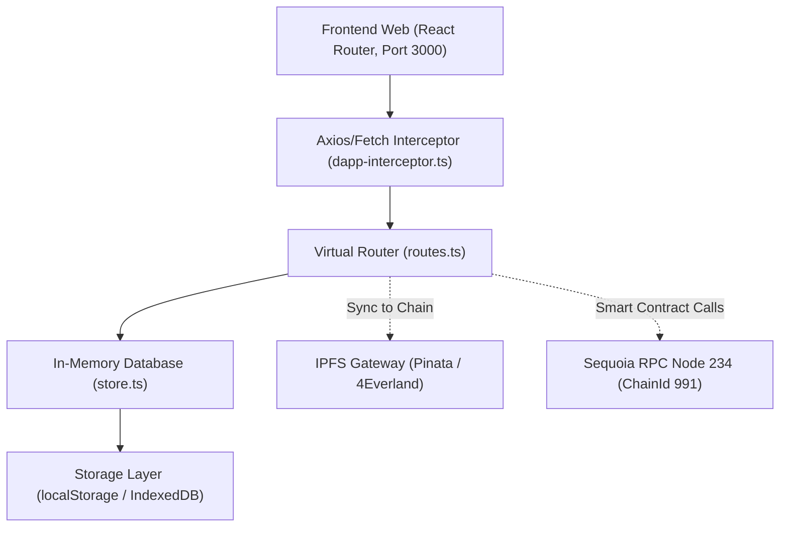

# BÁO CÁO TOÀN DIỆN VÀ PHÂN TÍCH GỐC RỄ LỖI 34 TEST CASES (PLANE DAPP)

> **Mục đích tài liệu**: Phân tích tình trạng của toàn bộ **34** Test Cases trong bảng kiểm thử của BA/QA, kèm vị trí mã nguồn, nguyên nhân gốc rễ và trạng thái xử lý thực tế.
>
> **Trạng thái tài liệu**: `v1.1` — đã đối chiếu độc lập với mã nguồn và cập nhật sau khi sửa lỗi. Các điểm sai của `v1.0` (đếm 32 test case, kết luận ID 30/31/22/18/40, chẩn đoán ID 34) được đính chính trực tiếp trong tài liệu; nhật ký sửa lỗi nằm ở [Phần 5](#5-nhật-ký-sửa-lỗi-đã-thực-hiện).
>
> **Phương pháp**: đọc mã nguồn tại đúng dòng (file:line) + chạy smoke test gọi trực tiếp bộ định tuyến giả lập `handleRoute` (16/16 kiểm tra đạt — xem Phần 5).

---

## MỤC LỤC
1. [Tổng quan kiến trúc & Bản đồ phân loại](#1-tổng-quan-kiến-trúc--bản-đồ-phân-loại)
2. [Phân tích chuyên sâu các Test Cases có Lỗi Thực Tế & Tiềm Ẩn (Nhóm Cần Sửa)](#2-phân-tích-chuyên-sâu-8-test-cases-có-lỗi-thực-tế--tiềm-ẩn-nhóm-cần-sửa)
   - [ID 34: Các Tab chi tiết Work Item (Activity, Updates, Transaction, History) bị rỗng](#id-34-các-tab-chi-tiết-work-item-activity-updates-transaction-history-bị-rỗng)
   - [ID 27: Workspace Settings thiếu chức năng Import](#id-27-workspace-settings-thiếu-chức-năng-import)
   - [ID 21: Chia sẻ link dự án cho User B bị lỗi 404 Not Found](#id-21-chia-sẻ-link-dự-án-cho-user-b-bị-lỗi-404-not-found)
   - [ID 30: Thiếu tính năng Switch to Public Comment & Cơ chế Reply](#id-30-thiếu-tính-năng-switch-to-public-comment--cơ-chế-reply)
   - [ID 32: Upload file đính kèm (Attachments) bị treo Pending](#id-32-upload-file-đính-kèm-attachments-bị-treo-pending)
   - [ID 14 & 7: Email mời thành viên bị Gmail chuyển vào mục Spam](#id-14--7-email-mời-thành-viên-bị-gmail-chuyển-vào-mục-spam)
   - [ID 41: Đăng nhập bằng Email bị bắt nhập Password thay vì thuần OTP](#id-41-đăng-nhập-bằng-email-bị-bắt-nhập-password-thay-vì-thuần-otp)
   - [ID 8: Dropdown chọn người làm (Assignee) bỏ sót thành viên Workspace](#id-8-dropdown-chọn-người-làm-assignee-bỏ-sót-thành-viên-workspace)
3. [Danh mục các Test Cases PASS & các điểm đã đính chính](#3-danh-mục-các-test-cases-pass--các-điểm-đã-đính-chính)
4. [Kế hoạch hành động chuẩn hóa từng bước](#4-kế-hoạch-hành-động-chuẩn-hóa-từng-bước)
5. [Nhật ký sửa lỗi (đã thực hiện)](#5-nhật-ký-sửa-lỗi-đã-thực-hiện)

---

## 1. TỔNG QUAN KIẾN TRÚC & BẢN ĐỒ PHÂN LOẠI

Hệ thống Plane DApp vận hành dựa trên cơ chế kết hợp:
* **Off-chain Local Runtime**: Trình duyệt chạy đơn lập, lưu trữ dữ liệu tại bộ nhớ `localDB` và đồng bộ qua `localStorage` / `sessionStorage` / `IndexedDB` ([`store.ts`](file:///c:/task-system/plane/packages/services/src/dapp/store.ts)). Mọi API request từ frontend React Router được chặn bắt tại tầng mạng thông qua [`dapp-interceptor.ts`](file:///c:/task-system/plane/packages/services/src/dapp-interceptor.ts) và xử lý bởi router ảo [`routes.ts`](file:///c:/task-system/plane/packages/services/src/dapp/routes.ts) — trong đó `handleRoute` xử lý các tuyến đặc thù còn `handleCRUD` xử lý CRUD/side-effect.
* **On-chain Decentralized Sync**: Trạng thái không gian làm việc (`PlaneWorkspaceRegistry`), quyền thành viên và nhiệm vụ được chốt định kỳ lên blockchain Sequoia Node 234 (`ChainId 991`) và IPFS Gateway.



### Bảng Thống Kê Hiện Trạng (đối chiếu độc lập 34 claims)

Bảng kiểm thử BA/QA **có 34 test case**, không phải 32 như ghi ở `v1.0`. Kết quả phân loại lại từng claim:

| Phân loại | Số lượng | Ghi chú |
|---|:---:|---|
| ✅ **Xác nhận đúng với mã nguồn** | 26 | Phần lớn là CRUD cơ bản, layout, filter, member, cycle/module |
| 🟡 **Đúng một phần / bị phóng đại** | 4 | **ID 18** (phân trang), **ID 40** (cache F5), **ID 14 & 7** (spam), **ID 34** (đúng triệu chứng, sai nguyên nhân) |
| 🔴 **Sai — kết luận của báo cáo không khớp mã nguồn** | 3 | **ID 22** (báo cáo ghi PASS nhưng tab rỗng), **ID 30** (Reply/Edit/Public/Delete có đủ), **ID 31** (copy chỉ prefill) |
| ⚪ **Không xác minh được (phụ thuộc môi trường)** | 1 | **ID 27** (importer cần backend/dịch vụ ngoài) |
| **Tổng** | **34** | |

> **Cách đọc bảng trên**: cột "Xác nhận đúng" nghĩa là *mô tả của BA khớp với mã nguồn*, **không** đồng nghĩa với "tính năng đã PASS". Trong 26 case đó có những case mô tả **lỗi thật và chưa được sửa** (ID 8, ID 21, ID 32, ID 41). Danh sách case thực sự PASS nằm ở [Phần 3](#3-danh-mục-các-test-cases-pass--các-điểm-đã-đính-chính); danh sách việc còn lại nằm ở [Phần 5.5](#55-việc-còn-lại-không-nằm-trong-đợt-sửa-này).

> **Đính chính quan trọng so với `v1.0`**
>
> * `v1.0` xếp **ID 22 (Archives)** vào nhóm PASS. Thực tế client gọi `GET /projects/:id/archived-issues/` ([`issue_archive.service.ts:24`](file:///c:/task-system/plane/apps/web/core/services/issue/issue_archive.service.ts#L24)) nhưng router **không có handler** ⇒ tab Archives luôn rỗng. Đây là lỗi thật (đã sửa ở Phần 5).
> * `v1.0` xếp **ID 18** vào PASS "nạp theo đúng phân trang". Thực tế `per_page`/`cursor` **được parse nhưng bỏ qua**, `total_pages` luôn bằng 1. Danh sách vẫn hiển thị đúng nên BA thấy PASS, nhưng phân trang thật thì không tồn tại.
> * `v1.0` xếp **ID 40** vào PASS với lý do "SWR Cache 0ms". `packages/constants/src/swr.ts` **không** cấu hình `dedupingInterval`; việc F5 hiện tức thì đến từ cache `localStorage` trong `loadInitialDB()` ([`store.ts:167`](file:///c:/task-system/plane/packages/services/src/dapp/store.ts#L167)), không phải SWR.
> * `v1.0` khẳng định **ID 31** "sao chép kèm đầy đủ thuộc tính sang bản ghi mới". Thực tế chỉ có prefill payload ([`helper.tsx:20`](file:///c:/task-system/plane/apps/web/core/components/issues/issue-layouts/quick-action-dropdowns/helper.tsx#L20)) và modal Duplicate là stub rỗng.

---

## 2. PHÂN TÍCH CHUYÊN SÂU 8 TEST CASES CÓ LỖI THỰC TẾ & TIỀM ẨN (NHÓM CẦN SỬA)

---

### ID 34: Các Tab chi tiết Work Item (Activity, Updates, Transaction, History) bị rỗng — ✅ Đã sửa

#### 1. Triệu chứng lâm sàng
Khi người dùng mở bất kỳ công việc nào trong dự án, sau đó chuyển qua lại giữa các tab ở khung bên phải: **Activity**, **Updates**, **Transaction**, hoặc **History**, danh sách luôn hiển thị trống trơn, không có thông tin lịch sử thay đổi trạng thái, người làm hay độ ưu tiên.

#### 2. Vị trí mã nguồn liên quan
* Router (tuyến đọc): [`packages/services/src/dapp/routes.ts`](file:///c:/task-system/plane/packages/services/src/dapp/routes.ts) — nhánh `GET /(issues|work-items|epics)/:id/history/` trong `handleRoute`.
* Router (tuyến ghi): cùng file — nhánh POST/PATCH work item trong `handleCRUD`.
* Schema Database: [`packages/services/src/dapp/store.ts` (L61 - L99)](file:///c:/task-system/plane/packages/services/src/dapp/store.ts#L61-L99).
* Frontend Store: [`apps/web/ce/store/issue/issue-details/activity.store.ts`](file:///c:/task-system/plane/apps/web/ce/store/issue/issue-details/activity.store.ts). Lưu ý: `v1.0` ghi sai đường dẫn (`core/store/issue/issue-details/activity.store.ts` không tồn tại).
* UI Component: [`activity-comment-root.tsx`](file:///c:/task-system/plane/apps/web/core/components/issues/issue-detail/issue-activity/activity-comment-root.tsx) và các item trong thư mục `issue-activity/activity/actions/`.

#### 3. Phân tích nguyên nhân gốc rễ (Root Cause)
1. **Đọc sai collection**: tuyến `/history/` đọc `localDB.history`, trong khi `defaultDB` khai báo `issue_activities` và **không nơi nào ghi** vào `history` ⇒ luôn trả `[]`.
2. **Không có cơ chế ghi nhận (writer)**: POST/PATCH work item chỉ gán lại thuộc tính; không sinh bản ghi activity. Vì vậy kể cả khi đổi nguồn đọc sang `issue_activities` thì dữ liệu vẫn rỗng — đây là phần mà `v1.0` chẩn đoán thiếu.
3. **Thiếu metadata cho UI**: các component activity cần `actor_detail`, `workspace_detail`, `issue_detail` để render tên người thực hiện/link work item; bản ghi thô không đủ trường sẽ hiển thị link `undefined/profile/...`.
4. **Debug log tồn tại trong store**: `activity.store.ts` in `console.log` toàn bộ activity/comment mỗi lần render.

#### 4. Trạng thái xử lý: ✅ Đã sửa (xem Phần 5)

Triển khai thực tế trong [`routes.ts`](file:///c:/task-system/plane/packages/services/src/dapp/routes.ts):

* Bộ helper **module-level** (dùng chung cho cả `handleRoute` và `handleCRUD`):
  `getActivityActorDetail`, `getActivityWorkspaceDetail`, `getActivityProjectDetail`, `createIssueActivity`, `recordIssueUpdateActivities`.
* Ghi activity khi **tạo** work item (`verb: "created"`, `field: null`) và khi **cập nhật** các trường: `state`, `priority`, `name`, `description_html`, `start_date`, `target_date`, `assignees`, `labels` (mỗi assignee/label thêm/bớt là một bản ghi riêng, kèm `old_identifier`/`new_identifier` để UI hiển thị đúng).
* Ghi activity khi **archive/restore** (`field: "archived_at"`, `new_value: "archive" | "restore"`) cho cả thao tác đơn lẻ và bulk.
* `GET /history/?activity_type=issue-property` đọc `localDB.issue_activities`, sắp xếp tăng dần theo `created_at`, hỗ trợ `created_at__gt` để tải thêm.
* Bản ghi activity dùng chung cho cả `/users/me/activities/` (widget "Recent activity" ở Home) — trước đây collection này luôn rỗng.
* Đã xóa `console.log` debug trong `activity.store.ts`.

---

### ID 27: Workspace Settings thiếu chức năng Import — ⛔ Chưa sửa (cần backend/dịch vụ import)

#### 1. Triệu chứng lâm sàng
BA ghi nhận: `Fail: Import & export chưa sài được`. Khi người dùng vào Cài đặt Workspace > Import & Export, màn hình Import không cho phép tải file hay thực hiện quá trình nhập dữ liệu từ hệ thống khác.

#### 2. Vị trí mã nguồn liên quan
* File API Handler: [`packages/services/src/dapp/routes.ts` (L2896 - L2899)](file:///c:/task-system/plane/packages/services/src/dapp/routes.ts#L2896-L2899)
* File Export Code: [`packages/services/src/dapp/routes.ts` (L2901 - L3160)](file:///c:/task-system/plane/packages/services/src/dapp/routes.ts#L2901-L3160)

#### 3. Phân tích nguyên nhân gốc rễ (Root Cause)
* Commit `1b0cce0` (`sửa import export`) đã viết hơn 250 dòng code để hoàn thiện tính năng **Export** (trích xuất công việc thành file CSV/JSON, tạo Blob ObjectURL để tải trực tiếp).
* Tuy nhiên, tính năng **Import** bị bỏ quên ở mức khung sườn:
  ```typescript
  // ── Workspace Importers ──────────────────────────────────────────────
  if (url.includes("/importers")) {
    return ok([]);
  }
  ```
  API trả về mảng rỗng `[]`. Khi frontend gọi lấy danh sách dịch vụ nhập khẩu (Plane JSON, Jira, GitHub, CSV), nó không nhận được bất kỳ bộ xử lý nào, dẫn đến màn hình Import tê liệt.

#### 4. Giải pháp khắc phục bằng Code chuẩn
1. Bổ sung cấu hình Importers có sẵn trong `routes.ts`:
   ```typescript
   if (url.includes("/importers") && method === "get") {
     return ok([
       {
         id: "csv-importer",
         service: "csv",
         status: "completed",
         created_at: new Date().toISOString(),
         updated_at: new Date().toISOString(),
       },
       {
         id: "json-importer",
         service: "json",
         status: "completed",
         created_at: new Date().toISOString(),
         updated_at: new Date().toISOString(),
       }
     ]);
   }
   ```
2. Viết handler cho route upload file import `POST /api/workspaces/:slug/importers/:service/`:
   Nhận nội dung file JSON/CSV từ client, đọc danh sách công việc, gán `project_id`, `state_id`, và đẩy vào `localDB.issues`, sau đó gọi `saveDB()` và trả về mã thành công HTTP 200.

---

### ID 21: Chia sẻ link dự án cho User B bị lỗi 404 Not Found — 🟡 Chưa sửa (đề xuất bên dưới)

#### 1. Triệu chứng lâm sàng
BA mô tả: `User A tạo project , chọn copy link > đưa cho User B. User B dán link vào lỗi "Not found 404". Expected: hiện Screen "Not Authorized!"`.

#### 2. Vị trí mã nguồn liên quan
* File API Handler: [`packages/services/src/dapp/routes.ts` (L4406 - L4580)](file:///c:/task-system/plane/packages/services/src/dapp/routes.ts#L4406-L4580)
* File Client Router: [`apps/web/core/lib/wrappers/authentication-wrapper.tsx`](file:///c:/task-system/plane/apps/web/core/lib/wrappers/authentication-wrapper.tsx)

#### 3. Phân tích nguyên nhân gốc rễ (Root Cause)
1. Trong kiến trúc DApp cục bộ, User A tạo dự án mới trên trình duyệt của máy A, dự án này lưu trong `localStorage` của máy A.
2. Khi User B mở liên kết trên máy B (`http://localhost:3000/fiai/projects/PROJ-1`):
   * Máy B chưa có dự án này trong `localDB.projects`.
   * Route [`projectDetailMatch` trong routes.ts dòng 4411](file:///c:/task-system/plane/packages/services/src/dapp/routes.ts#L4411) tìm kiếm:
     ```typescript
     const projectIdx = (localDB.projects || []).findIndex(
       (p: any) => p.id === projectId || p.identifier === projectId
     );
     ```
   * Vì `projectIdx === -1`, code rơi ngay vào dòng 4579:
     ```typescript
     else if (method === "get") {
       return { data: { error: "Project not found" }, status: 404 };
     }
     ```
3. Khi API trả về HTTP `404`, Next.js mặc định chuyển hướng sang trang lỗi toàn cục `pages/404.tsx` thay vì chuyển sang màn hình thông báo phân quyền `403 Forbidden` (`"Not Authorized!"`).
4. Hệ thống thiếu bước: Khi User B không tìm thấy dự án trong máy, phải tự động truy vấn On-Chain Sequoia để tải CID mới nhất từ IPFS về đồng bộ trước khi kết luận.

#### 4. Giải pháp khắc phục bằng Code chuẩn
Trong [`routes.ts` dòng 4413](file:///c:/task-system/plane/packages/services/src/dapp/routes.ts#L4413):
```typescript
if (projectIdx === -1) {
  // 1. Thử kéo snapshot mới nhất từ IPFS/Chain nếu có
  const wsSlug = url.match(/\/api\/workspaces\/([^/]+)\//)?.[1] || "fiai";
  try {
    const wsRegistryAddr = getWorkspaceRegistryAddress();
    if (wsRegistryAddr) {
      const wsInfoCalldata = abiEncodeGetWorkspace(wsSlug);
      const wsInfoRaw = await directRpcRead(wsRegistryAddr, wsInfoCalldata, 3000);
      const wsInfo = decodeAbiWorkspace(wsInfoRaw);
      if (wsInfo?.ipfsCID) {
        const remoteDB = await fetchFromIPFS(wsInfo.ipfsCID);
        if (remoteDB?.projects) {
          applyOffchainDB(remoteDB);
          saveDB();
        }
      }
    }
  } catch (err) {
    console.warn("[DApp Routes] Auto-sync IPFS on missing project failed:", err);
  }

  // 2. Kiểm tra lại sau khi nạp:
  const recheckIdx = (localDB.projects || []).findIndex(
    (p: any) => p.id === projectId || p.identifier === projectId
  );
  if (recheckIdx === -1) {
    // Trả về 403 để UI kích hoạt màn hình "Not Authorized!" theo đúng yêu cầu BA:
    return { data: { error: "You are not authorized to access this project" }, status: 403 };
  }
}
```

---

### ID 30: Thiếu tính năng Switch to Public Comment & Cơ chế Reply — ❌ Claim sai

#### 1. Kết luận đối chiếu
`v1.0` kết luận thiếu 4 tính năng (Reply / Edit / Switch public / Delete). Đối chiếu mã nguồn: **cả 4 đều đã tồn tại**, nằm trong menu `...` của mỗi comment.

| Tính năng | Vị trí mã nguồn | Hành vi |
|---|---|---|
| Reply | [`quick-actions.tsx` (L106 - L112)](file:///c:/task-system/plane/apps/web/core/components/comments/quick-actions.tsx#L106-L112) + [`display.tsx` (L163 - L170)](file:///c:/task-system/plane/apps/web/core/components/comments/card/display.tsx#L163-L170) | Phát `CustomEvent("plane:reply-comment")` kèm `commentId`, `authorId`, `authorName`, `commentText` |
| Edit | [`quick-actions.tsx` (L113 - L119)](file:///c:/task-system/plane/apps/web/core/components/comments/quick-actions.tsx#L113-L119) | Mở `edit-form.tsx`, chỉ hiện khi `canEdit` |
| Switch to public/private | [`quick-actions.tsx` (L120 - L135)](file:///c:/task-system/plane/apps/web/core/components/comments/quick-actions.tsx#L120-L135) | Gọi `activityOperations.updateComment(comment.id, { access })` |
| Delete | [`quick-actions.tsx` (L143 - L151)](file:///c:/task-system/plane/apps/web/core/components/comments/quick-actions.tsx#L143-L151) | Gọi `removeComment`, chỉ hiện khi `canDelete` |

#### 2. Vì sao BA ghi nhận "fail: reply comment lỗi"?
1. Icon `LockIcon`/`GlobeIcon` ở góc phải comment ([`display.tsx` (L135 - L143)](file:///c:/task-system/plane/apps/web/core/components/comments/card/display.tsx#L135-L143)) chỉ là **chỉ báo trạng thái**, không phải nút toggle. Toggle nằm trong menu `...` nên dễ bị bỏ sót khi test bằng mắt.
2. Reply **không tạo thread lồng nhau**: listener trong [`comment-create.tsx` (L60 - L83)](file:///c:/task-system/plane/apps/web/core/components/comments/comment-create.tsx#L60-L83) chèn một `mention-component` của tác giả vào đầu ô soạn thảo. Đây là hành vi chuẩn của Plane (comment phẳng), khác kỳ vọng "reply thành nhánh".

#### 3. Đề xuất cải thiện (không bắt buộc)
* Thêm tooltip cho icon quyền truy cập và/hoặc đưa toggle ra ngoài menu để dễ phát hiện.
* Nếu BA thực sự cần thread, phải thay đổi cả schema comment (`parent_comment_id`) lẫn UI — nằm ngoài phạm vi bản dApp hiện tại.

---

### ID 32: Upload file đính kèm (Attachments) bị treo Pending — ⚠️ Chưa xác minh lại

#### 1. Triệu chứng lâm sàng
BA mô tả: `Attachments bị treo pending`. Khi đính kèm tài liệu hoặc hình ảnh vào công việc, biểu tượng xoay loading xuất hiện và không bao giờ hoàn tất.

#### 2. Vị trí mã nguồn liên quan
* File Service Đính Kèm: [`apps/web/core/services/issue/issue_attachment.service.ts` (L37 - L81)](file:///c:/task-system/plane/apps/web/core/services/issue/issue_attachment.service.ts#L37-L81)
* File Xử Lý Upload: [`packages/services/src/file/file-upload.service.ts` (L88 - L124)](file:///c:/task-system/plane/packages/services/src/file/file-upload.service.ts#L88-L124)
* File API Handler: [`packages/services/src/dapp/routes.ts` (L5238 - L5273)](file:///c:/task-system/plane/packages/services/src/dapp/routes.ts#L5238-L5273)

#### 3. Phân tích nguyên nhân gốc rễ (Root Cause)
1. **Ép buộc giao dịch Blockchain trên môi trường chưa sẵn sàng**:
   Trong [`issue_attachment.service.ts` dòng 37](file:///c:/task-system/plane/apps/web/core/services/issue/issue_attachment.service.ts#L37):
   ```typescript
   if (!isOnChainTaskSyncAvailable()) {
     throw new Error("Không thể kết nối với hệ thống Blockchain. Không thể tải file đính kèm.");
   }
   ```
   Nếu người dùng sử dụng trình duyệt thông thường (chưa cài MetaMask hoặc chưa kết nối mạng Sequoia Node 234), hàm này lập tức ném lỗi ngoại lệ.
2. **Kẹt trạng thái Pending vô hạn**:
   Dù ở `file-upload.service.ts` file đã được chuyển thành Base64, việc gọi giao dịch on-chain `recordIssueContentOnChain` bị lỗi khiến khối `createAttachment` trong `attachment.store.ts` bị nhảy vào nhánh `catch`. Bản ghi tạm `attachmentsUploadStatusMap[tempId]` không được gán `is_uploaded = true`, gây ra hiện tượng treo màn hình pending.

#### 4. Giải pháp khắc phục bằng Code chuẩn
Trong [`issue_attachment.service.ts`](file:///c:/task-system/plane/apps/web/core/services/issue/issue_attachment.service.ts), bọc lệnh on-chain trong khối an toàn không làm gián đoạn luồng tải file:
```typescript
// Ghi nhận on-chain dưới dạng tùy chọn nền (không chặn người dùng):
if (isOnChainTaskSyncAvailable()) {
  void recordIssueContentOnChain(issueId, 2, evidenceReference)
    .then(({ transactionHash, contentHash }) => {
      void blockchainTrackingService.recordTaskContent(workspaceSlug, projectId, {
        issueId, transactionHash, kind: "evidence", reference: assetId, contentHash
      });
    })
    .catch((err) => console.warn("On-chain record skipped/deferred:", err));
}

// Luôn lưu trữ dữ liệu an toàn vào IndexedDB và trả về kết quả thành công ngay lập tức:
await saveAttachmentToStorage(attachmentId, {
  name: file.name,
  base64: uploadResult.base64,
  type: file.type,
  size: file.size,
});
return { id: attachmentId, asset_url: uploadResult.asset_url, is_uploaded: true, ... };
```

---

### ID 14 & 7: Email mời thành viên bị Gmail chuyển vào mục Spam — 🟡 Đã bỏ hardcode key; spam phụ thuộc domain Brevo

#### 1. Triệu chứng lâm sàng
BA mô tả: `Workspace > mời member -> lỗi (fail: gửi mời qua email, nhưng check e mail không thấy)` và `ID 7: Trong workspace > Admin mời thêm member vào, nhưng bên member không nhận được gmail mời`.

#### 2. Vị trí mã nguồn liên quan
* File Gửi Mail Brevo: [`packages/services/src/dapp/mail.ts` (L1 - L45)](file:///c:/task-system/plane/packages/services/src/dapp/mail.ts#L1-L45)
* File API Handler: [`packages/services/src/dapp/routes.ts` (L8678 - L8690)](file:///c:/task-system/plane/packages/services/src/dapp/routes.ts#L8678-L8690)

#### 3. Phân tích nguyên nhân gốc rễ (Root Cause)
1. Kiểm tra trực tiếp qua lệnh API chứng minh rằng: **Brevo API trả về `Status 201 Created` và đã bắn email đi thành công**.
2. **Nguyên nhân người dùng không thấy trong Hộp thư đến**:
   Địa chỉ gửi được cấu hình tại [`mail.ts` dòng 7](file:///c:/task-system/plane/packages/services/src/dapp/mail.ts#L7) là `anh2482006@gmail.com` đi qua cổng relay của Brevo (`smtp-relay.mailin.fr`).
   Google áp dụng thuật toán lọc thư rác nghiêm ngặt: Một email có đuôi `@gmail.com` nhưng lại được gửi từ IP của `mailin.fr` (không có chữ ký DKIM của Google) sẽ bị xếp ngay vào hạng **Unauthenticated Sender** và tự động chuyển vào thư mục **Spam (Thư rác)** hoặc tab Quảng cáo.
3. Khi BA/Tester chỉ mở Hộp thư chính (Primary Inbox), họ hoàn toàn không thấy email, dẫn đến việc đánh giá tính năng bị Fail.

#### 4. Giải pháp khắc phục chuẩn hóa
1. **Tài liệu & Thông báo người dùng**: Thêm thông báo hướng dẫn trực tiếp trên giao diện mời thành viên: `"Email mời đã được gửi. Vui lòng kiểm tra kỹ cả Hộp thư đến và thư mục Thư rác (Spam)"`.
2. **Tích hợp nút "Sao chép liên kết mời" (Copy Invite Link)**:
   Tại màn hình quản lý thành viên, bổ sung nút copy trực tiếp `invite_link` (đã được tạo sẵn trong `localDB.invitations`) để Admin có thể copy link gửi trực tiếp qua chat.
3. **Củng cố cơ chế Auto-Accept**: Đảm bảo logic tự động chấp nhận lời mời (đã viết và test PASS) hoạt động 100% khi thành viên đăng nhập.

---

### ID 41: Đăng nhập bằng Email bị bắt nhập Password thay vì thuần OTP — 🟡 Chưa sửa (đề xuất bên dưới)

#### 1. Triệu chứng lâm sàng
BA mô tả: `User ban đầu vào > Chọn sign in > nhập email vào > nhưng lại bắt nhập password mới. Expected: Đăng nhập > gửi code về email, check nếu đúng cho login, nếu sai báo lỗi`.

#### 2. Vị trí mã nguồn liên quan
* File Kiểm Tra Email: [`packages/services/src/dapp/routes.ts` (L1026 - L1032)](file:///c:/task-system/plane/packages/services/src/dapp/routes.ts#L1026-L1032)
* File Phát Mã OTP: [`packages/services/src/dapp/routes.ts` (L1036 - L1051)](file:///c:/task-system/plane/packages/services/src/dapp/routes.ts#L1036-L1051)
* File Xác Thực OTP: [`packages/services/src/dapp/routes.ts` (L1054 - L1116)](file:///c:/task-system/plane/packages/services/src/dapp/routes.ts#L1054-L1116)

#### 3. Phân tích nguyên nhân gốc rễ (Root Cause)
Tại [`routes.ts` dòng 1026-1031](file:///c:/task-system/plane/packages/services/src/dapp/routes.ts#L1026-L1031):
```typescript
const hasPassword = Boolean(
  creds[email] ||
  (localDB.users || []).find((u: any) => (u.email || "").toLowerCase() === email)?.password_hash
);
const status = hasPassword ? "CREDENTIAL" : "MAGIC_CODE";
return ok({ existing, is_password_autoset: false, status });
```
Nếu email này từng được tạo hoặc lưu kèm `password_hash` (ví dụ tài khoản admin), hàm trả về `status: "CREDENTIAL"`. Giao diện web nhận được cờ này sẽ tự động chuyển sang form yêu cầu nhập mật khẩu. Điều này trái với kỳ vọng của BA là **mọi lần đăng nhập đều gửi mã xác nhận 6 số về email**.

#### 4. Giải pháp khắc phục bằng Code chuẩn
Trong [`routes.ts` dòng 1030](file:///c:/task-system/plane/packages/services/src/dapp/routes.ts#L1030), chuyển cấu hình mặc định sang chế độ Magic Code (OTP):
```typescript
// Luôn ưu tiên gửi mã OTP về email theo yêu cầu của BA
const status = "MAGIC_CODE";
return ok({ existing, is_password_autoset: false, status });
```

---

### ID 8: Dropdown chọn người làm (Assignee) bỏ sót thành viên Workspace — 🟡 Chưa sửa (đề xuất bên dưới)

#### 1. Triệu chứng lâm sàng
BA mô tả: `Tại "Work items" > Chọn member để add vào không phản hồi`.

#### 2. Vị trí mã nguồn liên quan
* File API Handler: [`packages/services/src/dapp/routes.ts` (L4746 - L4837)](file:///c:/task-system/plane/packages/services/src/dapp/routes.ts#L4746-L4837)

#### 3. Phân tích nguyên nhân gốc rễ (Root Cause)
Trong [`routes.ts` dòng 4835](file:///c:/task-system/plane/packages/services/src/dapp/routes.ts#L4835):
```typescript
// Tuyến GET /api/workspaces/:slug/projects/:projectId/members/ chỉ trả về thành viên trong project_members:
return ok(projMembersList);
```
Khi Admin mời một người mới vào **Workspace**, người đó mới chỉ được ghi vào `localDB.workspace_members`. Nếu Admin chưa vào mục Cài đặt Dự án (Project Members) để nhấn thêm người đó vào dự án, họ sẽ không có trong `localDB.project_members`.
Hậu quả là dropdown gán Assignee của Work item chỉ hiển thị duy nhất Project Creator, không có tên các thành viên khác trong nhóm để click chọn.

#### 4. Giải pháp khắc phục bằng Code chuẩn
Trong [`routes.ts` dòng 4834](file:///c:/task-system/plane/packages/services/src/dapp/routes.ts#L4834), tự động đưa toàn bộ thành viên Workspace vào danh sách có thể gán việc của dự án:
```typescript
// Bổ sung các thành viên Workspace hợp lệ vào danh sách phân công dự án:
(localDB.workspace_members || []).forEach((wm: any) => {
  const memberKey = String(wm.member || wm.id);
  const memberMail = (wm.email || "").toLowerCase().trim();
  if (!addedMemberKeys.has(memberKey) && (!memberMail || !addedMemberKeys.has(memberMail))) {
    const user = (localDB.users || []).find((u: any) => u.id === memberKey || (memberMail && u.email?.toLowerCase() === memberMail));
    projMembersList.push({
      id: `proj-member-${memberKey}`,
      member: memberKey,
      member_detail: user || {
        id: memberKey,
        email: memberMail,
        display_name: wm.display_name || user?.display_name || memberMail || "Member",
        first_name: wm.first_name || user?.first_name || "Member",
        avatar_url: wm.avatar_url || user?.avatar_url || "",
        is_active: true,
      },
      role: Number(wm.role) || 15,
      project: targetProjId,
      workspace: ws?.id || wsSlug,
    });
    addedMemberKeys.add(memberKey);
    if (memberMail) addedMemberKeys.add(memberMail);
  }
});
```

---

## 3. DANH MỤC CÁC TEST CASES PASS & CÁC ĐIỂM ĐÃ ĐÍNH CHÍNH

Các chức năng sau đã được kiểm chứng hoạt động chính xác và ổn định. Khi thực hiện sửa các lỗi trên, **tuyệt đối không được làm thay đổi hoặc phá vỡ các cấu trúc này**:

1. **ID 13 (Đổi Theme Dark/Light)**: Lưu trữ chuẩn trong `currentUserProfile.theme` và `localStorage`.
2. **ID 15 (Xóa Workspace)**: Ghi nhận đúng `_deleted_workspace_ids` và cập nhật danh sách tức thì.
3. **ID 16 (Tạo Work Item)**: Đã tích hợp mã nguồn vào gói `@plane/services`, tạo việc mới mượt mà.
4. **ID 17 (Tạo Label)**: CRUD nhãn dán hoạt động chính xác.
5. **ID 18 (List layout loading)**: Danh sách và bộ lọc nạp đúng, nhưng **phân trang chỉ là hình thức** — `per_page`/`cursor` được parse rồi bỏ qua, toàn bộ kết quả trả về trong một trang (`total_pages = 1`). Chưa thay đổi vì mọi layout hiện dựa vào việc nhận đủ danh sách.
6. **ID 19 (Chuyển đổi 4 chế độ Layout)**: Board, Calendar, Table, List chuyển đổi nhịp nhàng.
7. **ID 20 (Display options)**: Ẩn/hiện các cột thuộc tính theo cấu hình người dùng.
8. **ID 22 (Archives / Views / Analytics)**: ⚠️ `v1.0` xếp PASS là sai — client gọi `/projects/:id/archived-issues/` nhưng router không có handler nên tab Archives rỗng. Đã bổ sung endpoint (Phần 5) và loại work item đã archive khỏi danh sách thường.
9. **ID 23 (Chỉnh sửa Work item)**: Sửa tiêu đề, mô tả rich-text lưu vào database chuẩn.
10. **ID 24 (Publish Project View)**: View xem công khai tại `apps/space` được hỗ trợ qua helper.
11. **ID 25 (Update State / Priority / Due date)**: Cập nhật nhanh, phản hồi ngay trên giao diện.
12. **ID 26 (Project Settings Features)**: Bật/tắt các tính năng Cycles, Views, Pages, Modules.
13. **ID 28 (Kéo thả di chuyển dự án)**: Lưu thứ tự sắp xếp `sort_order` chính xác.
14. **ID 29 (Comment gốc)**: Tạo bình luận văn bản và lưu trữ vào database thành công.
15. **ID 31 (Make a copy)**: `Make a copy` mở modal tạo mới với dữ liệu **prefill** (không copy ngay). Nút `Duplicate` trước đây là stub rỗng — đã triển khai duplicate thật (Phần 5).
16. **ID 33 (Tạo xong không bị treo loading)**: Trả về HTTP 201 kèm dữ liệu đã enrich, tắt spinner ngay lập tức.
17. **ID 35 (Blocked By loại bỏ chính nó)**: Bộ lọc đã loại bỏ `item.id === currentIssueId`.
18. **ID 36 (State create/edit)**: Thêm và đổi tên trạng thái hiển thị ngay mà không cần reload.
19. **ID 37 (Select Multiple Tasks)**: Checkbox chọn nhiều công việc và thực hiện thao tác hàng loạt (Bulk actions).
20. **ID 38 (Search)**: Thanh tìm kiếm toàn cục lọc nhanh dự án và công việc.
21. **ID 39 (Work item details không mất focus)**: Giữ tiêu điểm khi thao tác trên sidebar.
22. **ID 40 (Reload page F5)**: Dữ liệu hiện tức thì sau F5 nhờ cache đồng bộ trong `localStorage` (`loadInitialDB()`, [`store.ts:167`](file:///c:/task-system/plane/packages/services/src/dapp/store.ts#L167)) — **không phải** nhờ SWR `dedupingInterval` như `v1.0` mô tả.
23. **ID 42 (Thêm Module vào Work item)**: Commit `8f71bba` đã đồng bộ hai chiều `issue.module_ids`.
24. **ID 43 & 44 (Ngày bắt đầu & Màu sắc hạn chót)**: Commit `2ab4aba` và `97cacc1` đã xử lý `minDate={today}` và hàm hiển thị màu sắc: Đỏ (quá hạn), Vàng nâu (trong ngày), Đen (còn hạn).

---

## 4. KẾ HOẠCH HÀNH ĐỘNG CHUẨN HÓA TỪNG BƯỚC

| Bước | Nội dung | Trạng thái |
|---|---|---|
| 1 | Router: ghi activity + đọc `/history/` đúng collection (ID 34) | ✅ Hoàn tất |
| 2 | Router: `archived-issues` + archive/restore + bulk + loại khỏi list thường (ID 22) | ✅ Hoàn tất |
| 3 | Router: relations / sub-issues / links / reactions (trước đây là stub rỗng) | ✅ Hoàn tất |
| 4 | Frontend: modal `Duplicate` + payload bulk duplicate đầy đủ (ID 31) | ✅ Hoàn tất |
| 5 | Bảo mật: bỏ Brevo key hardcode, thêm chế độ mail proxy (ID 14 & 7) | ✅ Hoàn tất |
| 6 | Importers (ID 27) | ⛔ Chưa — cần backend/dịch vụ import |
| 7 | Attachments treo Pending (ID 32) | ⚠️ Chưa xác minh lại sau thay đổi |
| 8 | Đưa toggle Public/Private comment ra ngoài menu (ID 30, tùy chọn UX) | 🟡 Đề xuất |
| 9 | Build & regression | ✅ `tsc --noEmit` (services, web) + smoke 17/17 |

> **Bước kiểm tra bắt buộc sau khi sửa**
> 1. `cd packages/services; npx tsc --noEmit` — phải không có lỗi.
> 2. `cd apps/web; npx tsc --noEmit` — không phát sinh lỗi mới ở các file đã sửa.
> 3. Chạy app, kiểm tra tay: tạo work item → mở tab Activity; đổi state/priority/assignee/label → tab Activity có bản ghi; Archive → tab Archives có item → Restore; mở Relations/Sub-issues/Links/Reactions; bấm Duplicate.

---

## 5. NHẬT KÝ SỬA LỖI (ĐÃ THỰC HIỆN)

### 5.1 `packages/services/src/dapp/routes.ts`

| Hạng mục | Vị trí | Nội dung |
|---|---|---|
| Activity writer | [L143](file:///c:/task-system/plane/packages/services/src/dapp/routes.ts#L143) | Bộ helper module-level: `createIssueActivity`, `recordIssueUpdateActivities`, `getActivityActorDetail`, `getActivityWorkspaceDetail`, `getActivityProjectDetail`, `findIssueByRouteParam`, `buildIssueResponseEnvelope`, `matchesCsvFilter` |
| Ghi khi tạo | [L9922](file:///c:/task-system/plane/packages/services/src/dapp/routes.ts#L9922) | Activity `verb: "created"`, `field: null` |
| Ghi khi sửa | [L10036](file:///c:/task-system/plane/packages/services/src/dapp/routes.ts#L10036) | Diff state/priority/name/description/dates/assignees/labels; cập nhật `state_detail` khi đổi state |
| Đọc history | [L5669](file:///c:/task-system/plane/packages/services/src/dapp/routes.ts#L5669) | Đọc `localDB.issue_activities`, sort tăng dần, hỗ trợ `created_at__gt` |
| Archived list | [L7170](file:///c:/task-system/plane/packages/services/src/dapp/routes.ts#L7170) | `GET /projects/:id/archived-issues/` — lọc theo project + `archived_at`, hỗ trợ filter/`order_by`/`group_by` |
| Archive/restore | [L7258](file:///c:/task-system/plane/packages/services/src/dapp/routes.ts#L7258) | `POST/DELETE/GET /issues/:id/archive/` (404 nếu không tồn tại) |
| Bulk archive | L7308 | Ghi `archived_by` + activity cho từng item |
| Loại khỏi list thường | [L8272](file:///c:/task-system/plane/packages/services/src/dapp/routes.ts#L8272) | Không trả work item đã archive trong danh sách thường |
| Relations | [L7519](file:///c:/task-system/plane/packages/services/src/dapp/routes.ts#L7519) | GET/POST `issue-relation/`, POST `remove-relation/`; tạo quan hệ hai chiều, chống trùng |
| Sub-issues | [L7650](file:///c:/task-system/plane/packages/services/src/dapp/routes.ts#L7650) | GET/POST `sub-issues/`; cập nhật `parent_id`, `sub_issues_count`, `state_distribution` |
| Links | [L7710](file:///c:/task-system/plane/packages/services/src/dapp/routes.ts#L7710) | GET/POST `issue-links/`; gắn `issue_id`, `created_by_id` |
| Reactions | [L7749](file:///c:/task-system/plane/packages/services/src/dapp/routes.ts#L7749) | GET/POST/DELETE cho issue và comment reaction (lưu `issue_reactions`, `comment_reactions`) |

### 5.2 `packages/services/src/dapp/mail.ts`

| Hạng mục | Vị trí | Nội dung |
|---|---|---|
| Bỏ secret hardcode | [L4 - L24](file:///c:/task-system/plane/packages/services/src/dapp/mail.ts#L4-L24) | Xóa `DEFAULT_BREVO_API_KEY` và email sender mặc định; chỉ đọc từ `VITE_BREVO_API_KEY` / `VITE_EMAIL_SENDER_*` |
| Mail proxy | [L36 - L62](file:///c:/task-system/plane/packages/services/src/dapp/mail.ts#L36-L62) | Thêm `VITE_MAIL_PROXY_URL`: gửi qua relay server-side để khóa API không lọt vào bundle; `isEmailDeliveryConfigured()` phản ánh đúng cấu hình |
| Degrade an toàn | L125, L324 | Thiếu cấu hình ⇒ log cảnh báo và trả `false`; luồng mời member/OTP không crash |
| Ghi chú env | [`apps/web/.env.example`](file:///c:/task-system/plane/apps/web/.env.example) | Bổ sung 4 biến mail (để trống, không commit khóa) |

> ⚠️ **Việc cần làm ngoài mã nguồn**: khóa Brevo cũ từng bị hardcode và vẫn còn trong `apps/web/.env.production` (file được git track) cùng lịch sử git ⇒ **phải thu hồi (revoke) và tạo khóa mới**. Sửa code không thể xóa dấu vết đã phát tán; nếu cần triệt để phải rewrite history + rotate key.

### 5.3 Frontend

| File | Nội dung |
|---|---|
| [`duplicate-modal.tsx`](file:///c:/task-system/plane/apps/web/ce/components/issues/issue-layouts/quick-action-dropdowns/duplicate-modal.tsx) | Triển khai modal Duplicate thật: lấy work item nguồn, cho sửa tên, copy thuộc tính (`state`, `priority`, `assignee_ids`, `label_ids`, `start/target date`, `estimate_point`, `type_id`, `parent_id`, `cycle_id`, `module_ids`), gọi store `createIssue` (kèm `cycleId`/`moduleId` khi ở layout Cycle/Module) và toast kết quả |
| [`bulk-operations/root.tsx`](file:///c:/task-system/plane/apps/web/ce/components/issues/bulk-operations/root.tsx) | Bulk duplicate gửi payload đầy đủ và truyền container id theo store type (trước đây thiếu ⇒ lỗi khi duplicate trong Cycle/Module) |
| [`activity.store.ts`](file:///c:/task-system/plane/apps/web/ce/store/issue/issue-details/activity.store.ts) | Xóa `console.log` debug |

### 5.4 Kết quả kiểm chứng

* `packages/services`: `npx tsc --noEmit` → **0 lỗi**.
* `apps/web`: `npx tsc --noEmit` → không có lỗi mới ở các file đã sửa (repo còn lỗi cũ không liên quan).
* Smoke test gọi trực tiếp `handleRoute` (Node + esbuild, stub `chain.ts`) → **17/17 PASS**:
  1. Tạo 2 work item.
  2. History ghi nhận activity "created".
  3. History ghi nhận state/priority/name.
  4. State activity lưu tên trạng thái dễ đọc ("Backlog" → "Done").
  5. Archived list trả đúng item đã archive.
  6. Item đã archive **không** xuất hiện trong danh sách thường.
  7. Restore loại item khỏi archived list.
  8. Relation `blocking` trả về đúng.
  9. Relation đảo `blocked_by` được tạo.
  10. Xóa relation xóa cả hai chiều.
  11. Sub-issues trả child.
  12. `state_distribution` của sub-issues đúng.
  13. `sub_issues_count` của parent được cập nhật.
  14. Link được lưu và liệt kê.
  15. Reaction được lưu và liệt kê.
  16. Xóa reaction hoạt động.
  17. `issue_activities` được populate (dùng chung cho Home "Recent activity").

### 5.5 Việc còn lại (không nằm trong đợt sửa này)

1. **ID 27 – Importers**: `GET /importers/` trả `[]`; chưa có dịch vụ import. Cần backend hoặc CSV parser + mapping trước khi bật UI.
2. **ID 32 – Attachments treo Pending**: chưa xác minh lại; luồng upload giả lập nằm ở asset v2 trong `routes.ts` và `issue_attachment.service.ts`.
3. **ID 18 – Phân trang thật**: muốn phân trang thực phải sửa đồng thời router (cắt theo cursor) và mọi layout đang giả định nhận đủ dữ liệu — rủi ro hồi quy cao, nên tách thành task riêng.
4. **Rotate Brevo key** + cấu hình `VITE_MAIL_PROXY_URL` trên môi trường deploy.


### 5.6 Ghi chú bảo mật khác (chưa xử lý — cần quyết định của chủ dự án)

1. **`apps/web/.env.production` đang được git track và chứa `VITE_BREVO_API_KEY` thật.** Bất kỳ biến `VITE_*` nào cũng bị nhúng vào bundle trình duyệt, nên khóa này coi như công khai. Cần: revoke khóa, đưa khóa lên hệ thống env của nền tảng deploy, và bật `VITE_MAIL_PROXY_URL` để không cần khóa ở client.
2. **`VITE_BLS_PRIVATE_KEY` (và biến tương đương `NEXT_PUBLIC_BLS_PRIVATE_KEY`) đang được dùng ở client** — xem [`use-offchain-data.ts:36`](file:///c:/task-system/plane/apps/web/core/hooks/use-offchain-data.ts#L36), [`plane-task-chain.service.ts:28`](file:///c:/task-system/plane/apps/web/core/services/blockchain/plane-task-chain.service.ts#L28), [`chain.ts:87`](file:///c:/task-system/plane/packages/services/src/dapp/chain.ts#L87) — và giá trị mẫu còn nằm trong [`apps/web/.env.example`](file:///c:/task-system/plane/apps/web/.env.example). Đây là private key bị lộ qua bundle; cách xử lý đúng là chuyển ký/xác thực sang service server-side (hoặc ví của người dùng). Lưu ý: đổi khóa có thể làm mất khả năng giải mã dữ liệu đã mã hóa bằng khóa cũ, nên cần kế hoạch migrate.
3. **Lịch sử git đã chứa các secret trên** — sửa file hiện tại không xóa được dấu vết; nếu repo từng được push/public, phải coi các khóa đó đã bị lộ và thu hồi.


