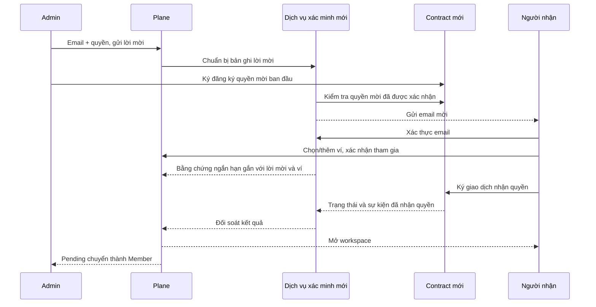

# Kế hoạch hoàn thiện luồng member — v1.1 — phạm vi mã/test đã duyệt

**Quyết định mới nhất của chủ dự án:** chuyển sang thêm trực tiếp bằng địa chỉ ví. Admin chọn Member/Admin, ký một giao dịch cấp quyền; Member dùng đúng ví mở workspace, không nhận lời mời/OTP hoặc chờ duyệt lần hai. Không database, không verifier, không cần deploy v3 cho luồng này. Phạm vi tự nhận email bên dưới được giữ như lịch sử và không còn là điều kiện hoàn tất phương án đã chọn. Xem [báo cáo triển khai hiện hành](/C:/task-system/plane/BAO_CAO_THEM_MEMBER_BANG_VI_2026-10-29.md).

Ngày lập: 29/10/2026. Phạm vi: Plane DApp, xác thực người nhận, quyền thành viên trên chain và trải nghiệm quản lý member.

**Lịch sử v1.0:** đây là tài liệu trình duyệt trước khi triển khai. Chủ dự án sau đó đồng ý làm mã và kiểm thử theo kế hoạch. Deployment, migration, env, hạ tầng, dependency mới và test mail/ví thật vẫn theo điểm duyệt D6.

**Điều chỉnh v1.1 theo xác nhận mới:** chỉ local/IPFS/chain; không PostgreSQL/SQLite, không lưu OTP/session bằng tệp hoặc storage phía dịch vụ. Quyết định này thay thế đề xuất database ở phần 5.2 và D1 bên dưới. Ghi nhận chi tiết, kết quả và những phần chưa hoàn tất tại [tiến độ triển khai](/C:/task-system/plane/MEMBER_FLOW_IMPLEMENTATION.md). Phần mô tả v1.0 được giữ để đối chiếu lịch sử, không phải chấp thuận cài database.

## 1. Kết quả cần đạt

Admin chỉ cần nhập email, chọn quyền và gửi lời mời. Chưa biết ví người nhận vẫn mời được. Người nhận xác thực email, chọn/thêm ví và xác nhận tham gia. Admin không nhận địa chỉ ví qua tin nhắn, không duyệt ví lần hai và không phải gửi lại link vì người nhận vừa thêm ví.

Lời mời không đồng nghĩa với thành viên. Chỉ ghi nhận thành viên sau khi quyền được xác nhận trên chain. Admin thấy Pending chuyển sang Member bằng cùng nguồn dữ liệu mà phía người nhận sử dụng.

Không thể cam kết mọi dịch vụ bên ngoài luôn không lỗi. Mục tiêu nghiệm thu là: không báo thành công giả, không mất dữ liệu, không tự cấp sai quyền, không treo vô hạn và có cách tiếp tục rõ ràng khi xảy ra gián đoạn.

## 2. Cách hiểu bằng chứng trong tài liệu

- **Đã xác nhận:** đã đọc trực tiếp nhánh mã được dẫn; khi chưa tái hiện bằng ví thật thì chỉ kết luận về hành vi của mã, không khẳng định một giao dịch cụ thể ngoài hệ thống đã xảy ra.
- **Nguyên lý kỹ thuật:** phân biệt dữ liệu do trình duyệt tự khai với bằng chứng được bên có thẩm quyền hoặc contract kiểm tra.
- **Đề xuất/chưa kiểm chứng:** kiến trúc mới, tên trạng thái, thông số vận hành và tiêu chí hiệu năng bên dưới. Chưa có kết quả test cho luồng mới vì chưa triển khai.

[Bộ kiểm chứng trước đây](/C:/task-system/plane/docs/verification/invitations-2026-10-27/validation.json) ghi 145 kiểm thử và 9 tình huống Chrome của luồng hiện có. Các kết quả đó là baseline chống hồi quy, không chứng minh luồng tự nhận lời mời bằng email đã hoạt động.

## 3. Những điểm đã xác nhận khi rà soát

| Mã | Hiện trạng | Tác động và hướng xử lý |
| --- | --- | --- |
| M01 | [Xử lý nhận lời mời](/C:/task-system/plane/packages/services/src/dapp/workspace-invitations.ts:141) chặn khi chưa gắn/duyệt ví. | Đây là lý do Admin hiện phải làm thêm một bước; phải thay cơ chế cấp quyền, không chỉ bỏ nút duyệt. |
| M02 | [Contract](/C:/task-system/plane/contracts/PlaneWorkspaceRegistry.sol:154) lưu lời mời theo địa chỉ ví; chưa có quyền nhận lời mời bằng email. | Cần một cơ chế nhận quyền mới có kiểm tra nguồn mời và danh tính email. |
| M03 | [Xác thực OTP](/C:/task-system/plane/packages/services/src/dapp/auth.ts) tạo/lưu/kiểm tra mã tại trình duyệt; có nhánh tạo hồ sơ tự gán email đã xác minh. [Đăng ký bằng mật khẩu](/C:/task-system/plane/apps/web/app/entry.client.tsx) lưu thông tin đăng nhập local. | Không được dùng riêng các cờ hoặc dữ liệu local này để tự cấp quyền trên chain. Cần xác thực email từ dịch vụ tin cậy. |
| M04 | [Hàm xuất snapshot](/C:/task-system/plane/packages/services/src/dapp/store.ts:1133) đưa credentials và dữ liệu user có password hash vào snapshot. | Phải tách dữ liệu xác thực khỏi dữ liệu workspace được chia sẻ; không lấy hash từ snapshot làm chứng cứ đăng nhập mới. |
| M05 | [Các hàm cập nhật CID](/C:/task-system/plane/contracts/PlaneWorkspaceRegistry.sol:202) cho phép member cập nhật snapshot. | Không được mặc định mọi lời mời/role ghi trong snapshot đều do Admin phê duyệt. Quyền mời mới phải có nguồn riêng được contract xác thực. |
| M06 | [API mà UI gọi](/C:/task-system/plane/apps/web/core/services/user.service.ts:245) đi qua đường members/leave đang bị [guard quản trị](/C:/task-system/plane/packages/services/src/dapp/routes.ts:617) kiểm tra. [Nhánh rời workspace](/C:/task-system/plane/packages/services/src/dapp/routes.ts:3238) còn nhận alias workspace-members/leave, xóa local trước và bắt lỗi chain rồi trả thành công; [hàm gọi chain](/C:/task-system/plane/packages/services/src/dapp/chain.ts:1971) lại yêu cầu quyền quản trị. | Member thường có thể bị chặn ngay từ guard; đường alias có nhánh trả thành công dù chain chưa rời. Cần thống nhất quyền cho API tự rời, thêm thao tác self-leave ở contract và chỉ báo thành công sau đối soát. Đây là đối chiếu mã, chưa tái hiện bằng ví thật. |
| M07 | [Nhánh xóa member](/C:/task-system/plane/packages/services/src/dapp/routes.ts:3521) chỉ thu hồi chain khi đủ điều kiện SDK/địa chỉ ví. Guard phía trước chặn SDK không sẵn sàng ở đường API quản trị thông thường. | Chưa đủ căn cứ kết luận có thể vượt guard bằng cách ngắt SDK. Cần test trường hợp không phân giải được ví/đi qua alias, phân biệt xóa bản nháp với thu hồi member thật và cấm báo thành công khi chưa chứng minh đã thu hồi. |
| M08 | [Ánh xạ quyền](/C:/task-system/plane/packages/services/src/dapp/chain.ts:184) đưa Guest và một số giá trị khác thành Member; [quyền UI](/C:/task-system/plane/packages/constants/src/user.ts:36) có Guest nhưng contract chưa có quyền tương ứng. | Phải chốt tập quyền. Không được hiển thị Guest trong khi thực tế cấp Member. Giá trị role không được hỗ trợ phải bị từ chối rõ ràng. |
| M09 | [Gộp dữ liệu giữa các tab](/C:/task-system/plane/packages/services/src/dapp/store.ts:934) có nhánh đối chiếu member theo email/ví mà không kèm workspace; cờ active có thể gỡ dấu xóa. | Cần khóa định danh theo workspace và đối soát quyền thật; tránh dữ liệu workspace A tác động workspace B hoặc dữ liệu cũ làm sống lại member. Đây là rủi ro suy ra từ nhánh mã, cần test tái hiện. |
| M10 | [Gửi lời mời](/C:/task-system/plane/packages/services/src/dapp/routes.ts:8764) đưa trường hợp chưa biết ví vào danh sách cảnh báo chain. [UI quản trị](/C:/task-system/plane/apps/web/app/(all)/[workspaceSlug]/(settings)/settings/(workspace)/members/page.tsx) có thể hiển thị cảnh báo chung. | Trong luồng mới, chưa biết ví là trường hợp bình thường; không được hiện như một lỗi giao dịch. |
| M11 | [Từ chối lời mời](/C:/task-system/plane/packages/services/src/dapp/workspace-invitations.ts) hiện lưu phản hồi trên thiết bị, không công bố trạng thái chung từ người nhận. | Admin/thiết bị khác có thể vẫn thấy Pending. Cần trạng thái từ chối bền vững, được xác thực, không giả làm đã thu hồi chain. |
| M12 | [Danh sách member](/C:/task-system/plane/apps/web/core/components/workspace/settings/members-list.tsx) tải qua SWR và sự kiện local; chưa có cơ chế trong thành phần này bảo đảm cập nhật từ một máy khác sau một khoảng thời gian xác định. | Cần cơ chế bắt kịp dữ liệu từ chain/dịch vụ, làm mới khi focus và cập nhật có giới hạn khi màn hình đang mở. |
| M13 | [Mô hình lời mời](/C:/task-system/plane/packages/types/src/workspace.ts:45) chưa biểu diễn đầy đủ việc gửi mail, xác thực email, giao dịch đang chờ và phục hồi. | Phải có trạng thái nghiệp vụ rõ ràng, không gom mọi thất bại thành link chết hoặc báo lỗi chung. |

Đọc SDK được thực hiện ở chế độ chỉ đọc. [Danh sách action của Vault](/C:/metanode-sdk/frames/crypto-vault/src/core/actions.ts) có chức năng ký; [implementation hiện đọc](/C:/metanode-sdk/frames/crypto-vault/src/modules/crypto/application/use-cases/create-sign.usecase.ts) gọi thư viện BLS. Điều này **chưa chứng minh** có thể gọi một API ký thông điệp Ethereum bất kỳ và xác minh bằng contract theo đúng định dạng mong muốn. Không suy đoán API hoặc sửa SDK để vượt qua điểm này.

## 4. Luồng nghiệp vụ đề xuất

### 4.1. Admin gửi lời mời

1. Nhập email và quyền; không bắt nhập ví.
2. Kiểm tra email trùng trong cùng workspace, member đã tham gia, lời mời đang còn hạn và quyền thực sự của Admin.
3. Chuẩn bị lời mời có ID riêng, version, quyền và hạn dùng. Lời mời ở bước chuẩn bị chưa được coi là đã gửi.
4. Admin xác nhận giao dịch đăng ký quyền mời. Đề xuất gộp nhiều người trong cùng một giao dịch nếu giới hạn gas cho phép; lô lớn phải chia và báo kết quả từng phần.
5. Contract xác nhận lời mời do người có quyền tạo. Dịch vụ mới đưa email vào hàng đợi gửi; không gửi link chưa thể sử dụng.
6. Admin thấy Pending. Trạng thái gửi mail được hiển thị riêng: đang gửi, nhà cung cấp đã nhận yêu cầu, gửi lỗi hoặc bounce nếu có thông tin từ nhà cung cấp.

**Admin vẫn có thể cần xác nhận ví khi gửi lời mời ban đầu. Đây là sự chấp thuận ban đầu; không có bước duyệt lại sau khi người nhận thêm ví.** Nếu muốn Admin không ký ngay cả ở bước gửi, phải thiết kế và duyệt một cơ chế ủy quyền khác, không tự suy ra từ đăng nhập bằng email.

### 4.2. Người nhận chưa có tài khoản hoặc chưa có ví

1. Mở link → thấy đúng workspace và người gửi đã được kiểm tra. GET/prefetch không chấp nhận hoặc tiêu thụ lời mời.
2. Xác thực email qua dịch vụ. Có thể dùng phiên email đã xác minh còn hiệu lực để tránh OTP lặp lại. Người mới được tạo hồ sơ tối thiểu sau khi xác thực, không bị ép tạo workspace khác.
3. Chọn ví hoặc mở ứng dụng ví để thêm ví. Khi quay lại phải giữ nguyên lời mời và tiến trình.
4. Hiển thị workspace, quyền và ví sẽ nhận quyền trước khi xác nhận.
5. Hệ thống cấp bằng chứng nhận quyền ngắn hạn, ràng buộc đúng lời mời và ví đã chọn.
6. Người nhận ký giao dịch tham gia. Contract kiểm tra bằng chứng và địa chỉ thực sự gửi giao dịch.
7. Sau khi quyền được xác nhận: tạo bản ghi member đã xác minh, cập nhật hồ sơ và mở workspace.
8. Việc tải dữ liệu dự án có thể tiếp tục riêng. Nếu IPFS tạm lỗi nhưng quyền đã được xác nhận, không yêu cầu ký tham gia lại.

### 4.3. Người nhận đã có tài khoản

- Giữ nguyên toàn bộ ngữ cảnh lời mời qua đăng nhập và onboarding.
- Nếu chỉ có tài khoản local hoặc cờ email verified cũ, vẫn phải xác thực email qua dịch vụ mới trước lần nhận quyền đầu tiên.
- Sai tài khoản: nói rõ tài khoản đang dùng không phải người được mời; cho đổi tài khoản mà không xóa nháp/cached workspace.
- Đã có quyền bằng đúng ví: mở workspace, không tạo thêm member hoặc tự thay đổi role. Việc nâng/hạ quyền member hiện hữu đi qua thao tác quản trị riêng.
- Link đã hết hạn nhưng người dùng đã là member được xác minh: có thể hướng dẫn mở workspace bằng quyền hiện có; không dùng điều đó để cấp quyền cho ví mới.

### 4.4. Phía Admin sau khi người nhận tham gia

- Pending được xác định bằng trạng thái lời mời có thẩm quyền, không chỉ bằng cờ accepted trong localStorage.
- Khi chain xác nhận đúng lời mời đã được nhận, người đó rời Pending và xuất hiện trong Members.
- Số đếm ở tiêu đề, sidebar, bộ lọc và danh sách dùng cùng một tập member đã xác minh; Pending không được cộng vào Members.
- Admin không ký thêm giao dịch duyệt ví, không bấm Sync thủ công để hợp thức hóa quyền và không phải gửi lại email trong đường đi bình thường.

Sơ đồ là thiết kế đề xuất, chưa phải các endpoint/hàm đang tồn tại.

## 5. Kiến trúc đề xuất và ranh giới tin cậy

### 5.1. Quyền mời được ghi nhận từ Admin

Contract mới lưu quyền mời theo ID lời mời thay vì yêu cầu biết ví người nhận ngay từ đầu. Mỗi quyền mời gồm định danh workspace, cam kết danh tính người nhận, role, hạn dùng, version và trạng thái còn hiệu lực/đã nhận/đã thu hồi.

Đăng ký và thay đổi quyền mời phải qua kiểm tra Admin/Owner trên chain. Không cấp quyền từ một record trong snapshot có thể bị Member sửa, từ một URL tự tạo hoặc từ role mà frontend gửi lên.

Không đưa email rõ lên chain. Thiết kế cam kết danh tính phải xem xét khả năng đoán email từ hash; hash email đơn thuần không mặc nhiên bảo vệ danh tính. Cách dùng dữ liệu ngẫu nhiên/cam kết sẽ được chốt trong đặc tả và kiểm thử, không lưu bí mật đó trong snapshot công khai.

### 5.2. Dịch vụ xác minh mới, nằm ngoài trình duyệt và ngoài SDK

Đề xuất một dịch vụ nhỏ cho OTP/session, hồ sơ lời mời, hàng đợi mail và đối soát trạng thái chain. Workspace/task vẫn theo mô hình local-first và IPFS; dịch vụ này không thay toàn bộ backend Plane.

Phương án kỹ thuật ưu tiên để trình duyệt là dịch vụ TypeScript chạy phía server, tái sử dụng các kiểu dữ liệu phù hợp trong monorepo; storage có giao dịch và ràng buộc duy nhất, đề xuất PostgreSQL khi chạy nhiều tiến trình. Đây là **đề xuất**, không khẳng định máy hiện có sẵn PostgreSQL hoặc đã chọn nơi hosting. Nếu dùng storage tương đương có sẵn thì phải chứng minh cùng tính bền vững/nhất quán. Chưa thêm package, chọn phiên bản dependency hoặc sửa Docker.

Yêu cầu tối thiểu:

- Lưu trạng thái bền vững, có giao dịch/unique constraint cho việc chuẩn bị và nhận một lời mời trên nhiều thiết bị. Bộ nhớ của một process, localStorage hoặc cache eventual-consistency đơn thuần không đủ cho khóa nhận quyền.
- OTP tạo/kiểm tra phía server, giới hạn thử lại, hạn dùng và resend; session xác minh không thể giả bằng sửa JSON local.
- Xác thực lời mời từ contract trước khi phát bằng chứng; phiên email phải khớp người nhận.
- Khóa ký xác minh riêng ở môi trường server; không dùng khóa ví Admin chung và không đặt vào biến được bundle cho trình duyệt.
- Khóa dịch vụ chỉ làm chứng danh tính cho lời mời hợp lệ. Contract không cho khóa đó tự tạo workspace, tự chọn role tùy ý hoặc tự thêm member khi Admin chưa mời.
- Đây vẫn là một bên tin cậy cho danh tính email: nếu khóa xác minh bị chiếm, kẻ tấn công có thể giả danh người nhận của lời mời còn hiệu lực. Cần khóa riêng, kiểm soát truy cập, bằng chứng ngắn hạn, audit và cơ chế ngừng/đổi verifier làm mất hiệu lực vé cũ. Không tuyên bố kiến trúc đã loại bỏ hoàn toàn rủi ro của dịch vụ xác minh.
- Mail outbox, idempotency và retry có giới hạn; không coi provider nhận request là người nhận chắc chắn đã thấy mail trong inbox.
- Phía dịch vụ chống tạo job gửi trùng theo lời mời/version và loại email. Nếu provider không hỗ trợ idempotency/đối soát thì không hứa gửi email đúng một lần tuyệt đối; trường hợp chưa rõ kết quả có trạng thái riêng và không retry vô hạn. Gửi lại email có chủ đích không tạo thêm quyền mời.
- API công khai chỉ trả dữ liệu tối thiểu; chống dò email/link, không log OTP, token nguyên văn hoặc session.
- Session được bảo vệ phía server; nếu dùng cookie thì có kiểm soát CSRF và SameSite/Secure phù hợp môi trường. Origin được cho phép qua cấu hình; không mở credentialed CORS tùy ý để chữa lỗi kết nối.

**Chưa xác nhận** mail proxy hiện có hỗ trợ xác minh OTP, session, lưu trữ giao dịch hay hàng đợi. Không tự giả định có thể thêm các API này vào proxy. Nơi chạy, storage, dependency mới và chi phí phải được duyệt trước khi triển khai.

### 5.3. Một giao dịch của người nhận để nhận quyền

Phương án ưu tiên: dịch vụ ký bằng chứng email đã xác minh, ràng buộc với ví được chọn; chính giao dịch do ví đó gửi chứng minh người nhận kiểm soát ví. Không yêu cầu thêm một lần ký thông điệp chỉ để lặp lại việc chứng minh ví nếu giao dịch đã đáp ứng yêu cầu.

Contract kiểm tra đồng thời:

- Đúng chain, đúng địa chỉ contract, đúng workspace, ID lời mời và version.
- Lời mời do Admin hợp lệ tạo, còn hạn, chưa thu hồi, chưa dùng.
- Role đúng như Admin đã cấp, không lấy role từ trình duyệt hoặc lời khai của dịch vụ.
- Bằng chứng từ khóa xác minh đang được cho phép, còn hạn và khớp cam kết danh tính.
- Ví trong bằng chứng bằng ví thật sự gửi giao dịch.
- Tiêu thụ quyền mời và thêm member trong cùng thao tác nguyên tử; hai thiết bị không nhận thành hai member.

Hết hạn, đổi role, thu hồi hoặc gửi lại phải làm mất hiệu lực bằng chứng cũ bằng version/trạng thái on-chain. Đăng ký lời mời không được cấp luôn membership.

### 5.4. Các điểm phải chứng minh trước khi chốt implementation

1. SDK gửi giao dịch từ đúng ví đã chọn và kết quả địa chỉ gửi khớp contract.
2. Chữ ký của dịch vụ được xác minh đúng trong môi trường contract mục tiêu; local Hardhat qua chưa đủ kết luận cho node MetaNode thật.
3. Có cách quan sát giao dịch thực sự được gửi, đã thành công hay đang chưa rõ; không lấy account lastHash làm receipt của thao tác hiện tại.
4. Chính sách vòng đời bằng chứng khi đổi ví, hủy và mất phản hồi phải được kiểm thử.

Nếu không đáp ứng được mà vẫn giữ nguyên SDK, phải quay lại trình phương án thay thế. Không lấy private key ra frontend, sửa SDK dùng chung hoặc nới điều kiện kiểm tra để làm cho test qua.

### 5.5. Tách quyền member khỏi snapshot dữ liệu dự án

- Chain là nguồn quyền. Dịch vụ giữ danh tính đã xác minh và trạng thái giao nhận email. Local/IndexedDB/SWR là cache/trạng thái hiển thị.
- IPFS không là kho OTP, credential, session, khóa ký hoặc nơi quyết định ai được làm Admin.
- Lỗi upload snapshot không được làm mất một quyền member đã được chain xác nhận; lỗi tải dự án được hiển thị như lỗi tải dữ liệu riêng.
- Token trong link là định danh/ngữ cảnh lời mời, không phải bằng chứng duy nhất để được cấp quyền. Không đưa token bí mật mới nguyên văn vào snapshot chia sẻ.
- Tách dữ liệu auth khỏi việc xuất/nhập snapshot. Snapshot cũ không được ghi đè credential/session mới hoặc tự đánh dấu email đã xác minh.

## 6. Trạng thái và cách xử lý để người dùng không bị mắc kẹt

| Tình huống | Trạng thái hiển thị | Hành động/điều kiện tiếp tục |
| --- | --- | --- |
| Admin chưa ký/giao dịch tạo mời chưa xác nhận | Chưa gửi / Đang gửi lời mời | Giữ draft; không tuyên bố email đã gửi. |
| Lời mời đã đăng ký nhưng mail lỗi | Đang chờ — gửi email chưa thành công | Gửi lại cùng lời mời; không tạo hàng loạt ID hoặc ký cấp quyền lại. |
| Email-only invite bình thường | Đang chờ người nhận | Không cảnh báo thiếu ví như lỗi chain. |
| Người nhận chưa xác thực email | Xác thực email để tiếp tục | OTP hoặc phiên server còn hợp lệ; giữ link. |
| Sai tài khoản | Lời mời dành cho tài khoản khác | Đổi tài khoản có chủ đích, giữ dữ liệu offline. |
| Chưa có/chưa mở khóa ví | Chọn/thêm/mở khóa ví | Quay lại đúng lời mời; không tạo request rỗng hoặc báo đã tham gia. |
| Người nhận đang ký | Đang chờ xác nhận trong ứng dụng ví | Chặn bấm lặp nhưng cho hủy rõ ràng nếu chưa gửi giao dịch. |
| Giao dịch đã gửi | Đang xác nhận tham gia | Theo dõi cùng operation; không gửi thêm chỉ vì tải lại trang. |
| Mất phản hồi sau khi ký | Đang kiểm tra kết quả | Đối soát quyền, trạng thái quyền mời và giao dịch; không báo thất bại cuối cùng khi chưa biết. |
| Chain xác nhận, index/profile còn chậm | Đã tham gia — đang tải dữ liệu | Không bắt ký lại; Admin cũng phải bắt kịp từ chain. |
| Lời mời hết hạn/thu hồi | Lời mời hết hạn/đã thu hồi | Admin có thao tác gửi lại khi phù hợp; không báo lỗi mạng thay thế. |
| Mạng/RPC/service tạm lỗi | Chưa kiểm tra được, có thể thử lại | Giữ tiến trình; không biến thành link hết hạn. |
| Đã tham gia từ thiết bị khác | Đã là thành viên | Mở workspace sau đối soát, không tạo member trùng. |
| Người nhận từ chối | Đã từ chối | Trạng thái chung được xác thực; không tự sống lại từ cache cũ. |

Không thêm toast cho từng lần polling; không bật lại hộp thoại ví khi người dùng đã hủy nếu họ chưa chủ động thử lại. Progress và nút thử lại phải có nội dung cụ thể; không để một spinner khóa toàn ứng dụng vô hạn.

## 7. Quy tắc vòng đời member cần chốt

### 7.1. Trùng email, gửi lại và thay đổi lời mời

- Một lời mời đang hoạt động cho một email trong cùng workspace; cùng email ở hai workspace là hai quyền riêng biệt.
- Member hiện hữu không được mời lại để âm thầm đổi role; chỉ ra đã là member và đưa Admin đến thao tác đổi quyền.
- “Gửi lại email” dùng cùng quyền mời và link khi còn hợp lệ. “Thay quyền/gia hạn/tạo lại sau thu hồi” tạo version mới và vô hiệu hóa version cũ.
- Không xóa bằng chứng thu hồi ID/version cũ chỉ vì mời lại cùng email. GET của trình quét bảo mật email không được tiêu thụ lời mời.
- Từ chối/thu hồi sau khi đã phát hành bằng chứng nhận quyền phải tính cả vé còn hiệu lực: cập nhật DB hoặc đóng modal chưa đủ để vô hiệu hóa vé đó. Chỉ báo đã vô hiệu hóa hoàn toàn khi trạng thái/version trên contract hoặc hạn vé chứng minh được điều này. Cơ chế vô hiệu hóa tự động từ dịch vụ, nếu cần, phải có phạm vi hẹp và được chứng minh ở P0; không dùng nó để yêu cầu Admin duyệt lại mọi người nhận.
- Trước khi claim phải kiểm tra người cấp còn có quyền quản trị theo chính sách được chốt. Đề xuất không tiếp nhận quyền từ người đã mất quyền quản trị; Admin hiện tại có thể cấp lại. Owner chuyển vai trò nhưng vẫn là Admin thì không tự làm mất lời mời chỉ vì thay chủ.

### 7.2. Ví nhận quyền

- Đề xuất một ví nhận quyền đang hoạt động cho mỗi danh tính trong một workspace ở đợt đầu. Không tự cấp cùng lời mời cho nhiều ví.
- Trước khi phát hành bằng chứng, người nhận có thể thay lựa chọn ví. Sau khi đã gửi giao dịch, giữ đúng ví và operation để đối soát.
- Sau khi đã phát hành bằng chứng nhưng chưa gửi xong, đổi ví phải tuân theo cơ chế hết hạn/hủy có thể kiểm chứng. Xóa local hoặc đóng modal không làm bằng chứng đã ký mất hiệu lực.
- Đề xuất chỉ có một phiên chuẩn bị nhận quyền đang hoạt động cho mỗi lời mời. Nếu cần đổi ví sau khi phát hành bằng chứng, phải có đường hủy thực sự hoặc chờ hết hạn có hiển thị thời gian, không âm thầm phát nhiều vé mâu thuẫn. Cách hủy tối ưu phải được chứng minh ở pha thử nghiệm kiến trúc.
- Sau khi đã là member, kết nối ví khác không tự chuyển quyền. Chuyển ví/mất ví là quy trình phục hồi riêng; không lợi dụng yêu cầu “không duyệt lần hai” của việc tham gia ban đầu để tự cấp thêm quyền.

### 7.3. Role, Owner và Guest

Đề xuất đợt đầu nghiệm thu Owner/Admin/Member đúng quyền hiện có trên chain. Owner là vai trò riêng ở giao diện quyền, không đồng nhất mọi Admin với Owner.

Không tiếp tục ánh xạ Guest thành Member. Nếu Guest phải dùng ngay, cần đưa Guest vào thiết kế contract, bảng quyền dự án và kiểm thử từ đầu. Nếu chưa có nhu cầu, ẩn lựa chọn Guest mới cho tới khi thực thi đầy đủ. Dữ liệu Guest/role không khớp cũ phải được liệt kê để chủ dự án duyệt, không tự nâng thành Member.

Không dùng so sánh số role đơn thuần khi mở rộng enum; phải dùng bảng quyền rõ ràng. Owner không được tự rời/xóa trước khi chuyển ownership. Admin không được lách giới hạn đối với Owner hoặc Admin ngang quyền bằng cách hạ quyền trước rồi xóa.

### 7.4. Đổi quyền, xóa member và tự rời

- Đổi quyền/xóa member thật: kiểm tra ví quản trị, gửi giao dịch, đọc lại quyền rồi mới cập nhật trạng thái thành công.
- Thiếu SDK, sai ví, thiếu địa chỉ member hoặc RPC lỗi: không được tự bỏ qua chain và xóa hàng local để báo thành công.
- Thêm thao tác tự rời vào contract cho chính member, có chặn Owner. Không dùng thao tác quản trị xóa member để giả lập tự rời.
- Sau rời/xóa, quyền cũ và lời mời đã dùng không tự khôi phục qua F5, tab cũ, cookie hay IPFS. Muốn tham gia lại cần lời mời/version mới hợp lệ.
- Gỡ quyền truy cập workspace/dự án tương ứng; giữ lịch sử người đã tạo task, bình luận và audit, không xóa nội dung công việc chỉ vì member bị xóa.
- Thu hồi quyền trên chain không xóa được dữ liệu IPFS công khai đã tải hoặc CID cũ. Nếu mục tiêu bao gồm bí mật nội dung sau khi xóa member, cần một phạm vi mã hóa/quản lý khóa riêng; không coi sửa membership là đã giải quyết việc đó.

## 8. Danh tính, đồng bộ và chống hồi quy dữ liệu cũ

- Khóa member gồm registry/chain, workspace chuẩn và ví; email là thuộc tính danh tính đã xác minh, không phải khóa ghi đè role giữa các workspace.
- ID danh tính mới ổn định giữa các thiết bị; ID user local cũ được lưu như alias cho hồ sơ/lịch sử khi cần. Không gộp hai người hoặc tự chuyển quyền chỉ vì email trong một snapshot trùng nhau.
- Ưu tiên ID workspace chuẩn, không nhập nhằng với workspace mặc định cũ. Trạng thái quyền đi kèm nguồn, block/version đã kiểm tra.
- Dữ liệu BroadcastChannel/cookie có thể yêu cầu làm mới cache, không tự trở thành bằng chứng cấp quyền hoặc gỡ thu hồi.
- Khi chain chưa đọc được, hiển thị bản cache kèm tình trạng chưa kiểm tra mới; không diễn giải lỗi RPC thành role None rồi xóa quyền local.
- Phiên xác minh email không đồng nghĩa với quyền Admin. Các thao tác đổi quyền, thu hồi, mời và xóa phải kiểm tra quyền quản trị hiện hành; không tin role cũ nằm trong token phiên.
- Một phép chiếu dữ liệu dùng cho list, count và sidebar; không tính Pending, bot hoặc record chưa xác minh vào số member thực.
- Admin và member ở hai máy độc lập phải thấy kết quả mới mà không cần chia sẻ localStorage. Sự kiện chain/index kết hợp refresh khi focus và polling có backoff khi màn hình liên quan đang mở.
- Lưu lại operation đang xử lý để refresh/tab mới tiếp tục được. Idempotency phải có ở backend/contract, không chỉ bằng khóa JavaScript trong một tab.
- Không dựa vào một lần upload toàn bộ snapshot để ghi nhận lời mời hoặc membership. Snapshot dự án cũ không được làm mất quyền mời mới đã được đăng ký trên nguồn có thẩm quyền.

## 9. Thông số và mục tiêu trải nghiệm đề xuất

Các giá trị dưới đây là cấu hình khởi điểm để duyệt và đo lại, không phải số đo hiệu năng hiện tại:

| Hạng mục | Đề xuất |
| --- | --- |
| Hạn lời mời | Giữ mặc định 14 ngày; trạng thái hết hạn được kiểm tra theo nguồn có thẩm quyền. |
| OTP | Mặc định 10 phút, tối đa 5 lần sai; giới hạn resend và tổng lượt theo email/IP/lời mời ở server. |
| Bằng chứng nhận quyền | Ngắn hạn, đề xuất 5 phút; thử nghiệm thời gian mở khóa/ký ví trước khi chốt. Không hết hạn ngay giữa luồng bình thường. |
| Tương tác local | Mục tiêu phản hồi trạng thái trong 200 ms trên môi trường kiểm thử đã thống nhất; không đồng nghĩa chain hoàn tất trong 200 ms. |
| Đang chờ dịch vụ/chain | Có progress; quá ngưỡng chờ phải có trạng thái đối soát/thử lại. Không tự kết luận giao dịch thất bại vì HTTP timeout. |
| Admin bắt kịp membership | Mục tiêu trong 10 giây sau khi RPC/index đã quan sát được xác nhận, khi màn hình mở và mạng khỏe; đo riêng độ trễ chain và độ trễ UI. |
| Polling | Chỉ ở màn hình liên quan, giảm tần suất khi nền/offline, có backoff và dừng khi đạt trạng thái cuối. |
| Mật độ thông báo | Một thông báo cho một kết quả/thao tác; lỗi lặp từ polling không tạo toast liên tục. |

Không chốt một SLA finality của chain hoặc cam kết mail đến inbox khi chưa đo trên hệ thống thật.

## 10. Các pha thực hiện sau khi kế hoạch được duyệt

| Pha | Công việc | Bằng chứng hoàn thành / điều kiện qua pha |
| --- | --- | --- |
| P0 — đặc tả và kiểm chứng khả năng | Chốt nguồn quyền, tập role, ranh giới dịch vụ, schema trạng thái; thử đường giao dịch SDK và xác minh bằng chứng; rà các consumer registry. | Tài liệu giao thức, bảng quyền, sơ đồ dữ liệu, kết quả thử nghiệm tối thiểu. Nếu cần sửa SDK hoặc phát sinh cơ chế cấp quyền rộng hơn đề xuất thì dừng trình duyệt lại. |
| P1 — dịch vụ xác thực/lời mời | OTP/session server, lời mời riêng, storage bền vững, outbox, rate limit, version/idempotency, audit và khả năng phục hồi sau restart. | Test khác trình duyệt/thiết bị, sửa localStorage không tạo quyền; token/OTP không lọt vào snapshot/log; không tạo job gửi trùng hoặc quyền mời trùng; giới hạn của provider được ghi rõ. |
| P2 — contract | Đăng ký lời mời chưa cần ví; nhận bằng chứng gắn ví; tiêu thụ một lần; thu hồi/version; tự rời; quyền role; sự kiện đối soát. | Contract tests và kiểm tra chữ ký trong môi trường được cho phép. Không deploy vào mạng đang dùng ở bước này nếu chưa duyệt phát hành. |
| P3 — services và dữ liệu | Tách xử lý membership khỏi router lớn, gắn nguồn quyền mới, bỏ nguồn tin từ credentials local/snapshot, xử lý kết quả ký chưa rõ, giữ gateway giao dịch hiện có. | Integration tests chạy end-to-end qua adapter thật, không xóa local sớm, không tự dùng cơ chế fallback mở quyền. |
| P4 — giao diện Admin/member | Gửi email-only bình thường, xác thực email, chọn ví, progress, tiếp tục sau refresh, sai tài khoản, không vòng duyệt lại, Admin auto-refresh, count thống nhất. | Chrome hai profile độc lập, click thật/hit-test, mobile viewport, bàn phím; không overlay che nút hoặc spinner vô hạn. |
| P5 — toàn bộ vòng đời | Gửi lại/thu hồi/từ chối/đổi quyền/xóa/rời, role Guest nếu được duyệt, kiểm soát tab cũ và dữ liệu cũ, bảo toàn lịch sử công việc. | Tái hiện và khóa hồi quy các điểm M06–M12; người đã rời/xóa không sống lại; đúng quyền trong từng workspace/dự án. |
| P6 — kiểm thử chịu lỗi và rà soát | Race giữa claim/revoke/role change, hai thiết bị, service restart, RPC/IPFS/mail/Vault gián đoạn, mất phản hồi, schema cũ, liên kết cũ. | Không còn lỗi chặn luồng hoặc lỗ hổng cấp sai quyền chưa xử lý; báo cáo phân biệt mock và thật. |
| P7 — chuẩn bị chuyển dữ liệu | Preview nguồn ở block cố định, backup, thống kê owner/member/role/pending, chạy thử migration và resume, đối chiếu và lập kế hoạch rollback. | Manifest cụ thể để chủ dự án duyệt; không đổi env hoặc bắt đầu ghi chain chỉ vì đã test local. |
| P8 — phát hành được duyệt | Triển khai dịch vụ/contract, migrate, đối chiếu, cập nhật cấu hình và chạy smoke test được cho phép; theo dõi sau phát hành. | Receipt/log thực, quyền và dữ liệu đích khớp manifest, test từ mailbox/ví đã được chỉ định, tài liệu vận hành và rollback đã kiểm tra. |

Không ước lượng cứng số ngày/chi phí trước P0 và lựa chọn hosting. Sau P0 mới có căn cứ chốt khối lượng Guest, storage và tương thích chữ ký/SDK.

## 11. File và thành phần dự kiến tác động

| Thành phần | Phạm vi dự kiến |
| --- | --- |
| [Contract registry](/C:/task-system/plane/contracts/PlaneWorkspaceRegistry.sol), [contract tests](/C:/task-system/plane/contracts/PlaneWorkspaceRegistry.test.ts) | Quyền mời theo ID, nhận quyền, version, thu hồi, tự rời, role và sự kiện. ABI/typechain tạo lại từ artifact đã kiểm tra. |
| [Xử lý lời mời](/C:/task-system/plane/packages/services/src/dapp/workspace-invitations.ts), [policy](/C:/task-system/plane/packages/services/src/dapp/invitation-policy.ts), [token](/C:/task-system/plane/packages/services/src/dapp/invitation-tokens.ts) | Dùng phiên/bằng chứng đáng tin, bỏ yêu cầu duyệt ví lần hai trong luồng mới, duy trì tương thích link được phép migrate. |
| [Router](/C:/task-system/plane/packages/services/src/dapp/routes.ts), [chain adapter](/C:/task-system/plane/packages/services/src/dapp/chain.ts), [gateway](/C:/task-system/plane/packages/services/src/dapp/tx-gateway.ts) | Quyền quản trị, nhận/đổi/xóa/rời; chống giao dịch trùng; không coi lỗi hoặc lastHash là thành công. |
| [Auth local](/C:/task-system/plane/packages/services/src/dapp/auth.ts), [store](/C:/task-system/plane/packages/services/src/dapp/store.ts), [phép chiếu member](/C:/task-system/plane/packages/services/src/dapp/workspace-members.ts) | Tách dữ liệu xác thực khỏi snapshot, khóa theo workspace, không phục hồi quyền từ cờ local, một nguồn count/list. |
| [Trang lời mời](/C:/task-system/plane/apps/web/app/(all)/workspace-invitations/page.tsx), [native auth](/C:/task-system/plane/apps/web/app/entry.client.tsx), [navigation](/C:/task-system/plane/apps/web/helpers/invitation-navigation.ts) | Email thật, giữ ngữ cảnh, phiên mới, lựa chọn ví, phục hồi và trạng thái rõ ràng. |
| [Danh sách member](/C:/task-system/plane/apps/web/core/components/workspace/settings/members-list.tsx), [dòng Pending](/C:/task-system/plane/apps/web/core/components/workspace/settings/invitations-list-item.tsx), [store member](/C:/task-system/plane/apps/web/core/store/member/workspace/workspace-member.store.ts), [types](/C:/task-system/plane/packages/types/src/workspace.ts) | Admin không duyệt ví lần hai, trạng thái gửi/nhận, dữ liệu theo version, refresh và count. |
| [Gửi mail](/C:/task-system/plane/packages/services/src/dapp/mail.ts) và dịch vụ xác thực mới | Gửi từ môi trường server theo cơ chế được duyệt, không đưa quyền cấp danh tính vào trình duyệt. Vị trí dịch vụ/endpoint mới là thiết kế tương lai, chưa khẳng định tồn tại. |
| [Preview migration](/C:/task-system/plane/scripts/preview-workspace-registry-migration.mjs), [restore](/C:/task-system/plane/scripts/restore-workspace-registry.mjs), [backup](/C:/task-system/plane/scripts/backup-registry-snapshots.mjs) | Mở rộng theo schema mới, có thể resume, so sánh nguồn/đích, không phục hồi record đã xóa hoặc cấp role theo phỏng đoán. |

Chưa chỉ định package/dependency mới, port, hostname hoặc địa chỉ contract mới. Các giá trị triển khai phải nằm trong cấu hình môi trường; bí mật server không được đặt trong nhóm biến frontend. Không chỉnh bất kỳ file SDK nền tảng nào.

## 12. Ma trận kiểm thử bắt buộc

Mỗi nhóm cần kiểm tra UI, trạng thái API/dịch vụ và quyền cuối cùng trên chain, không chỉ toast.

| Nhóm | Các tình huống tối thiểu | Kết quả bắt buộc |
| --- | --- | --- |
| Gửi mời | Email-only, email + ví đã biết, mời nhiều người, email trùng, đã là member, sai role. | Đúng một quyền mời cho mỗi người/workspace; không cấp membership sớm. |
| Email | Người mới, người cũ local, phiên server hợp lệ, sai email, OTP sai/hết hạn/resend/quá số lượt. | Chỉ người sở hữu email được chuẩn bị nhận quyền; không tin cờ local. |
| Link | Chuyển tiếp link, prefetch/scanner, thiếu query, token bị sửa, link cũ sau gửi lại/thu hồi. | Không mở quyền nhờ chỉ có link; lỗi có nguyên nhân và đường phục hồi. |
| Ví | Không có ví, thêm ví, kho khóa, hủy nhập mật khẩu, đổi ví trước/sau khi phát bằng chứng. | Giữ lời mời và phiên email; không gắn quyền vào ví cache khác ví ký. |
| Bằng chứng | Sai contract/chain/workspace/ID/version/role/ví, sai signer, hết hạn, replay. | Contract từ chối, không có member mới hoặc role bị nâng. |
| Đồng thời | Hai tab/hai máy claim cùng invite; claim đua với revoke hoặc đổi role. | Tối đa một kết quả hợp lệ; kết quả chain quyết định, không khôi phục record cũ. |
| Mất phản hồi | SDK báo lỗi sau khi có thể đã gửi; mất tx hash; RPC/index chậm; reload lúc pending. | Đối soát trước khi gửi lại; không ký trùng hoặc báo thất bại cuối cùng quá sớm. |
| Thay đổi lịch sử chain | Sự kiện bị loại bỏ, block/hash thay đổi hoặc RPC trả hai góc nhìn khác nhau. | Tuân theo mức xác nhận đã cấu hình và đối soát lại; không giữ vĩnh viễn quyền/ảnh trạng thái từ một sự kiện đã mất. |
| Khác máy | Admin ở profile A, member ở profile B, không chung cookie/localStorage. | Admin tự bắt kịp Member và count đúng mà không cần ký/duyệt thêm. |
| Từ chối/thu hồi | Từ chối ở máy B, thu hồi trước/sau phát ticket, mời lại cùng email. | Trạng thái chung bền vững; version đã thu hồi không hoạt động lại. |
| Quyền | Member gọi API quản trị trực tiếp, Admin ngang quyền, Owner, Guest theo phạm vi duyệt. | Bảo vệ ở contract/dịch vụ, không chỉ ẩn nút ở UI. |
| Rời/xóa | Member tự rời, Owner tự rời, xóa khi Vault mất kết nối, thu hồi chain lỗi. | Không báo rời/xóa thành công nếu quyền thật chưa đổi; Owner phải chuyển chủ trước. |
| Dữ liệu cũ | Snapshot/cookie/tab cũ, placeholder workspace, tombstone email/ID/version, cache sau role change. | Không mất quyền đang hợp lệ, không sống lại người đã xóa, không nhầm workspace. |
| Bảo mật dữ liệu auth | Xuất snapshot, log, error response, browser cache, client bundle. | Không xuất credential, OTP, session hoặc khóa ký dịch vụ. |
| Dịch vụ | Restart, DB lỗi, hàng đợi gửi lại, mail provider từ chối, mất IPFS hoặc RPC. | Trạng thái và retry có giới hạn; không nhân bản thao tác hoặc mất tiến trình. |
| UX | Click nhanh nhiều lần, keyboard, màn hình nhỏ, back/refresh, đổi tài khoản. | Không overlay che form, không khóa vô hạn, thông báo không lặp dồn dập. |
| Dữ liệu công việc | Xóa/rời member đang có task/bình luận/lịch sử. | Thu hồi quyền nhưng giữ tác giả và lịch sử, không xóa nội dung liên quan. |

Chạy lại baseline 145 test và thêm test có ý nghĩa cho giao thức mới, contract, service và lỗi vòng đời đã tìm thấy; không đặt một tổng số test tùy ý làm tiêu chí chất lượng. Chrome cần thao tác chuột/keyboard thật, không chỉ gọi hàm hoặc click DOM xuyên overlay.

Sau kiểm thử mock phải có smoke test với mailbox/ví được chủ dự án chỉ định và cho phép, trên môi trường triển khai được duyệt. Không gọi luồng mới là hoàn tất end-to-end nếu chỉ có kết quả giả lập.

## 13. Chuyển contract và dữ liệu: không được làm mất workspace hiện có

Contract nguồn đang đọc là contract triển khai thông thường, không thấy cơ chế nâng cấp proxy trong mã này. Kế hoạch dự kiến dùng phiên bản mới; trước triển khai phải xác minh cách triển khai thực tế đang dùng.

1. Lấy danh sách đầy đủ workspace liên quan từ nguồn được kiểm tra, không chỉ mặc định một slug. Chụp block, địa chỉ nguồn, code/ABI version, owner, member, role, CID và lời mời đang còn hiệu lực; kiểm tra tất cả client đọc registry.
2. Backup và tạo manifest chuyển dữ liệu riêng, không nhét khóa hoặc env vào mã/tài liệu công khai.
3. Member đang có quyền: đối soát từ chain, giữ đúng role và Owner, không bắt mọi người nhận lại lời mời.
4. Pending wallet cũ: kiểm tra quyền mời/expiry/revocation ở nguồn trước khi chuyển.
5. Pending email cũ chưa có chứng cứ Admin đáng tin ngoài snapshot: xuất danh sách để Admin xác nhận một lần ở bước chuyển dữ liệu hoặc gửi lại. Không tự coi mọi record cũ là quyền hợp lệ.
6. Giữ ID/link cũ nếu bản ghi đủ điều kiện được chuyển và có ánh xạ rõ ràng. Không hứa mọi link đều giữ được khi đã hết hạn, thu hồi hoặc không còn nguồn hợp lệ. Không tự khôi phục lời mời mà chủ dự án đã xóa.
7. Dữ liệu Guest/role không khớp và member chưa có ví được liệt kê riêng để xử lý; không suy ra ví từ email giả hoặc tự nâng role.
8. Chạy migration trên môi trường thử, so sánh source/target; thử dừng giữa chừng và resume không ghi trùng.
9. Trong cutover, tạm dừng thao tác quản trị membership/lời mời theo kế hoạch; giữ nháp công việc local. Client cũ không được âm thầm dùng đường fallback cấp quyền theo policy cũ.
10. Chỉ sau khi manifest và cửa sổ cutover được duyệt mới deploy/migrate/đổi env. Kiểm tra tất cả env liên quan và ABI tạo lại; không hardcode địa chỉ mới.
11. Sau cắt chuyển, đối chiếu quyền, danh sách, count, pending và đường truy cập; kiểm tra tài khoản thật theo phạm vi đã được cho phép.

Rollback không thể chỉ đổi env về địa chỉ cũ nếu đã có thành viên/giao dịch mới ở registry mới. Phải có cách dừng ghi, xuất phần phát sinh, đối soát và phục hồi/migrate tương ứng. Lịch sử chain không thể bị xóa để giả như chưa có thay đổi. Contract cũ và backup được giữ theo thời hạn đã thống nhất, không tự dọn trong đợt triển khai.

## 14. Điều kiện nghiệm thu và điều kiện dừng

Chỉ nghiệm thu khi:

1. Admin mời bằng email, chưa biết ví, và người nhận thật tham gia được mà không có vòng duyệt ví thứ hai.
2. Đúng email, ví ký, workspace và role; không dùng localStorage hoặc snapshot để tự tạo quyền.
3. Hai thiết bị độc lập và refresh ở mọi bước không làm mất tiến trình, tạo member/tx trùng hoặc sai count.
4. Hủy, mạng lỗi hoặc chưa rõ kết quả có cách tiếp tục; không có đường báo thành công giả khi quyền chưa được xác nhận.
5. Admin cập nhật được trạng thái sau claim; không cần người nhận ký thêm một giao dịch upload snapshot để Admin thấy member.
6. Đổi quyền/xóa/rời/thu hồi hoạt động thật và không bị dữ liệu cũ làm sống lại.
7. Không phát sinh lỗi mức chặn luồng hoặc cấp sai quyền chưa xử lý; cảnh báo/tồn tại khác được liệt kê và chấp nhận rõ ràng.
8. TypeScript/build/test phù hợp qua; báo cáo tách kết quả mock, local và mạng thật, kèm hạn chế còn lại.
9. Migration giữ workspace/member/dữ liệu công việc được duyệt; rollback có quy trình đã kiểm tra.

Dừng pha và báo lại nếu cần sửa SDK, dependency/hạ tầng vượt phạm vi duyệt; không xác minh được định dạng bằng chứng trên node mục tiêu; nguồn migration không đầy đủ; thiếu cơ chế thu hồi; hoặc kiểm thử phát hiện cấp quyền chỉ bằng dữ liệu client. Không bỏ kiểm tra để tiếp tục phát hành.

## 15. Các quyết định đề nghị chủ dự án duyệt

| Quyết định | Phương án đề nghị | Hệ quả cần hiểu |
| --- | --- | --- |
| D1 — dịch vụ xác minh | Đồng ý thiết kế một dịch vụ xác thực nhỏ ngoài trình duyệt/SDK, có storage bền vững và mail outbox. | Local-first cho công việc vẫn giữ; email/member control không thể chỉ dựa vào localStorage. Nơi chạy, dependency, chi phí và cấu hình sẽ trình cụ thể trước khi triển khai. |
| D2 — thao tác ký | Admin ký chấp thuận lúc gửi lời mời; người nhận ký một giao dịch tham gia. Không Admin duyệt lần hai. | Không cam kết Admin không cần mở ví khi gửi. Số giao dịch/gas cho batch phải đo và kiểm thử. |
| D3 — tập role | Làm Owner/Admin/Member chuẩn trước; không cho mời Guest mới cho đến khi Guest được thực thi đúng. | Không tự đổi Guest cũ thành Member. Nếu cần Guest ngay, chọn mở rộng phạm vi để làm đầy đủ bảng quyền và contract. |
| D4 — ví nhận quyền | Một ví hoạt động cho mỗi danh tính trong một workspace; không tự chuyển quyền khi đổi ví. | Đổi ví/mất ví sau khi tham gia có quy trình phục hồi riêng. Đây không phải bước duyệt lại trong đường mời ban đầu. |
| D5 — dữ liệu/lời mời cũ | Member thật giữ nguyên quyền; pending cũ chỉ chuyển khi có nguồn đáng tin, phần không rõ trình Admin một lần ở cutover. | Không hợp thức hóa record cũ chỉ để giữ mọi link, không khôi phục lời mời đã xóa. |
| D6 — quyền triển khai | Duyệt kế hoạch để triển khai mã và kiểm thử cục bộ trước. Deployment dịch vụ, dependency mới, contract/migration/env và test mail/ví thật có điểm duyệt riêng bằng manifest cụ thể. | Chưa có giao dịch hoặc thay đổi hạ tầng nào được tự thực hiện trong lúc chờ duyệt kế hoạch. Không commit/push khi chưa được yêu cầu trực tiếp. |

Sau khi duyệt, đầu ra đầu tiên là đặc tả giao thức và kết quả kiểm chứng P0. Không bắt đầu bằng xóa nút duyệt ví hoặc thay địa chỉ contract trong env.
